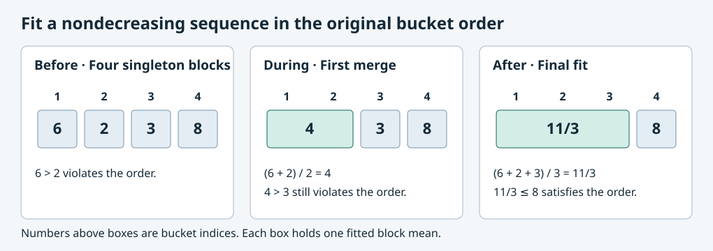

# Isotonic regression with a pooling stack

Fit ordered measurements when the fitted values must stay flat or increase.
Four load buckets with readings `6, 2, 3, 8` should return `11:3 8:1`.
Each record is `sum:count`. The expanded result is
`[11/3, 11/3, 11/3, 8]` and the squared error is `26/3`.



The fit minimizes the sum of squared changes while preserving bucket order.
A constant block's least-squares fit is its mean. Pool the first pair to 4.
That mean still exceeds 3, so pool backward again to 11/3. Compare adjacent
means using the cross products of their sums and counts. For at most 32,768
signed 32-bit observations, each product has magnitude at most 2^61. The
implementation uses signed 64-bit arithmetic.

| Candidate | Mechanism | Worst-case work |
|---|---|---|
| Shifting vector | Merge adjacent blocks and shift the remaining records after each deletion. | O(n²) |
| Stack PAVA | Push one observation at a time. Pop and pool with the predecessor while the adjacent means decrease or are equal. | O(n) |
| Lower hull | Keep the lower convex hull of cumulative (count, sum) points. Return the slopes of its edges. | O(n) |

Here n is the observation count. A falling input can make the shifting
baseline move (n−1)(n−2)/2 records, or three records for this example.
Each stack entry or hull point is added once and leaves at most once.
All three candidates use O(n) worst-case scratch and return compressed blocks.
Use the pooling stack for exact batch fitting, or the hull when a caller needs
its cumulative geometry. Allocate another output buffer if callers need one
fitted value per observation.

The chain, squared loss and equal observation weights define this lab. For
unequal weights, aggregate actual weights and weighted sums. An append can
revise earlier blocks. Finalize a closed batch or explicitly let callers revise
previous fits. For an upper envelope that can only raise readings, use prefix
maxima.

## Run

From the repository root:

```sh
cargo run -q -p isotonic-regression -- example
cargo test -p isotonic-regression
cargo build -p isotonic-regression --release
python3 topics/006-monotonic-stacks-and-deques/supplements/isotonic-regression/scripts/campaign.py target/release/isotonic-regression --check-only
```

The exact residual certificate requires every prefix of `observed − fitted`
inside a block to be nonnegative and the final sum to be zero.
For the first block the prefixes are 7/3, 2/3 and zero. This proves optimality
because a feasible perturbation is nondecreasing within the block. The runner
also enumerates every consecutive partition on small inputs independently.

See [measurements](measurements/README.md) and [the protocol](BENCHMARK.md) for
the tested selection.

- [Barlow and Brunk, The Isotonic Regression Problem and Its Dual](https://www.tandfonline.com/doi/abs/10.1080/01621459.1972.10481216)
- [de Leeuw, Hornik and Mair, Isotone Optimization in R](https://escholarship.org/uc/item/9zx9c72c)
