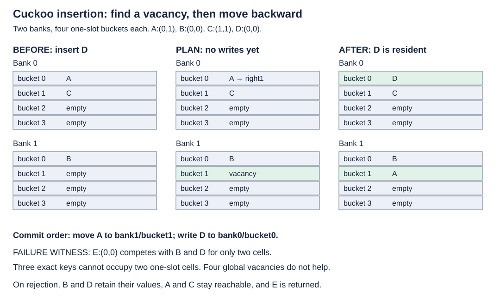

# Cuckoo hashing

Bound candidate locations by moving work into insertion. This single-owner Rust
experiment compares linear probing with two-bank cuckoo buckets of one or four
slots. It stores exact `u64` keys and values, including zero and `u64::MAX`.

## Contract and running example

`try_insert` updates an existing key and returns its old value. On rejection it
returns the incoming entry and preserves every slot/key/value. Capacity is fixed;
there is no stash, resize, randomized rebuild, panic recovery or concurrency.
`Budget` means the 64-record planner stopped early; `Exhausted` means its complete
reachable frontier contained no vacancy. Neither global occupancy nor a finite
budget alone certifies admission.



Two banks each have four one-slot buckets. A can occupy `(bank0,0)` or `(bank1,1)`;
B and D share bucket0 in either bank; C uses bucket1. Inserting D first finds a
vacancy in A's alternate bucket, moves A backward into it, then writes D. A fifth
key E sharing B/D's pair cannot fit: three keys require two cells, despite four
vacancies elsewhere. A single graph cycle is allowed; excess edges per connected
component are the single-slot obstruction.

Read-only breadth-first search records occupied-slot parents before committing.
The commit uses infallible copies of integer entries. A destructive kick algorithm
must preserve the current displaced resident, which may differ from the original
incoming key. A concurrent path requires lock/generation/occupancy/routing and
duplicate checks; this implementation provides none of those protocols.

## Cost and selection

For `r` buckets per bank and `b` slots per bucket, capacity is `M=2rb`, load is
`n/M`, and lookup examines at most `2b` candidate slots. With a scanned stash of
`s` entries, include `s`. The example has `r=4,b=1,n=4,s=0`: eight slots, half
occupancy, two candidate slots. Eight slots of the measured 24-byte `Option<Entry>`
reserve 192 bytes, excluding vector/allocator/search overhead.

The planner admits at most `L=64` occupied-slot records, including roots. Duplicate
and direct-vacancy scans examine at most `4b` slots. Each explored record
reads its occupant and scans at most b alternate slots. Total search slot reads
are bounded by `4b+L(b+1)`: 132 for b1, 336 for b4 at L=64.
Commit additionally moves at most L entries. Linear visited-record searches
cost up to `bL²` comparisons:
4,096 or 16,384. These are source-derived bounds,
not cycle or cache-miss measurements. The example moves one entry.

Linear probing favors local access and simple insertion; clustered misses and
backward deletion can be expensive. Cuckoo b1 offers two candidate slots but
limited local capacity. Cuckoo b4 offers eight candidate slots and more local
placement options, with larger scans. A bounded stash adds lookup work and can
fill; rebuilding adds allocation, movement and latency. Our fixed mixer and cap
have no imported randomized occupancy or expected insertion guarantee.

See [the frozen experiment](BENCHMARK.md) and [exact-source results](measurements/README.md).
Choose from correct candidates that admit the complete requested dataset. An
admission failure is not a faster completed build. No universal winner is claimed.

## Run

```bash
cargo test -p cuckoo-hashing --lib --examples --tests
cargo run -p cuckoo-hashing --example demo
python3 topics/016-cuckoo-hashing/measurements/runner.py --out /tmp/topic016-new-run
```

Expected: six library contract groups, two external contracts, unchanged map on
same-pair rejection, and explicit `REJECT` rows for incomplete datasets. The
runner compiles exact topic files with optimization level3 and native target
features; twelve balanced process blocks are the independent observations.

## Primary sources and limits

- [Pagh/Rodler ESA2001 author manuscript, §3](https://www.rasmuspagh.net/papers/cuckoo.pdf): two candidate cells and carrying the pending displaced key through rehash.
- [Devroye/Morin, The cuckoo graph](https://luc.devroye.org/cuckoo.pdf): single-slot component edge/vertex criterion; no reuse of its disputed probability derivations.
- [Kirsch/Mitzenmacher/Wieder full stash manuscript, §2](https://www.eecs.harvard.edu/~michaelm/postscripts/esa2008full.pdf): analyzed cycle-edge stashing differs from arbitrary capped-evictee stashing.
- [Minaud/Papamanthou arXiv v2, Lemma2/§4](https://arxiv.org/pdf/2010.01890v2): bucket-subset capacity and correction of the older generalized stash exponent. No probability guarantee transfers to this fixed two-bank b4 demo.
- [libcuckoo source 6a2555d](https://github.com/efficient/libcuckoo/blob/6a2555d551b7703d7176a5d114219a02c55d4038/libcuckoo/cuckoohash_map.hh): bounded search, validated backward movement, retries and resize; no whole-operation unchanged-layout guarantee inferred.

Revisit: transactional kick/rollback, stash policies, hashing families, tags and
compact buckets, hash-inclusive batch scheduling, resize tails, wider payloads,
true cold/startup cases and synchronized relocation. Catalog Topic016 has no extra
named coverage; Topic017 owns probabilistic filters and their error budgets.
