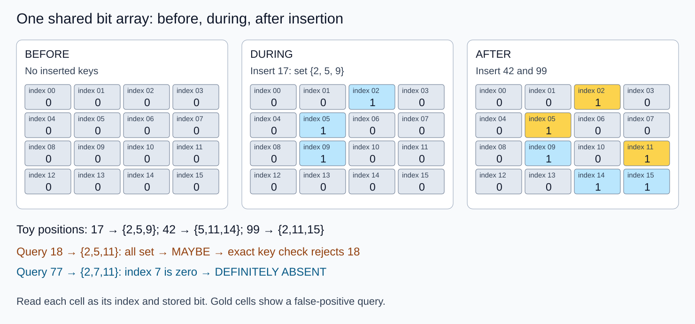

# Bloom, cuckoo, and quotient filters

A filter skips exact work for definite negatives; positives still need exact keys.
This lab compares complete exact query answers through a sorted-key authority.

## Contract and choices

- Standard Bloom: shared bits; insert-only, idempotent. No deletion API.
- Word-blocked Bloom: seven probes in one 64-bit word; occupancy skew raises error.
- Cuckoo: four u16 slots/bucket,12-bit nonzero tags,two XOR-related buckets.
  Breadth-first admission visits at most128 buckets, planning before mutation.
  Failure leaves buckets unchanged. Never delete on approximate membership alone.
  Duplicate occurrences consume slots; delete only a known outstanding occurrence.
- Quotient runs: high quotient/low12-bit remainder,explicit offset directory and
  sorted immutable runs. Fingerprints are deduplicated for this static contract.
  This is not compact original-QF metadata or a measured production QF.
- Ribbon witness: `solve_binary` solves byte-valued binary equations over at most64
  variables, rejecting contradictions. It is not a scalable Ribbon implementation.

No cryptographic, concurrent, persisted, or crash-safe contract is claimed.
Retain exact source keys and publish matching filter/exact generations. A stale
filter omitting a newly added exact key can introduce a false negative.

## Shared evidence



Toy positions are17→{2,5,9},42→{5,11,14},99→{2,11,15} in16 bits. Absent18
checks{2,5,11} and passes;77 checks{2,7,11} and is rejected. The real implementation
uses `mix` and rounds to whole64-bit words. The diagram is a mechanism witness,
not a report of those actual hash positions. All labels/cells were rendered and
inspected. Exact recheck rejects18.

## Cost model

With n keys,m bits,k probes,uniform-hashing approximation gives
`p≈(1-exp(-kn/m))^k`; n3,m16,k3 gives0.0796. Approximate optimal k is
`(m/n)ln2`,here3.70. Correlated hashes and finite arrays require validation.
Cuckoo compares up to2b tags; ideal nonzero f-bit tag bound is`2b/(2^f-1)`.
With b4,f12 it is8/4095≈0.195%; capacity and bounded insertion are separate.
Quotient fingerprint width q+r gives ideal bound`n/2^(q+r)`; n3,q2,r12 gives
3/16384≈0.0183%. These are model values,not certified measured distributions.

If F is filter cost,C exact cost,a absent fraction,p false-positive probability,
`filtered cost=F+[(1-a)+ap]C`. Filtering saves work when`F<a(1-p)C`.
Hypothetical F1µs,C100µs,a0.9,p0.08 gives18.2µs versus100µs. Extra build B50ms
needs more than`B/[a(1-p)C-F]≈611` queries. Every cost is illustrative.

## Run and selection

```bash
cargo test -p membership-filters
cargo run -p membership-filters --example demo
python3 topics/017-probabilistic-membership-filters/measurements/runner.py --out /tmp/topic017-replay
```

The runner invokes the demo and all source/contract tests,then400 fresh candidate
processes. Results,medians/ranges and exact input identities are in
[measurements/README.md](measurements/README.md). The complete lesson stays in the
chat and external evidence; this repository retains compact reproducibility.

Choose direct exact for cheap or hit-heavy queries,Bloom for insert-only compact
storage,cuckoo when safe deletion/admission rules fit,quotient organization for
runs/enumeration/compatible rebuilds,and Ribbon for amortized static generations.
Measure the whole query and build lifecycle; no universal winner is established.

## Named coverage and revisit

This round teaches Bloom,cuckoo,quotient,Ribbon,false-positive budgets and exact
rechecks. Revisit compact quotient occupied/continuation/shifted metadata,wraparound
and deletion; scalable Ribbon/binary-fuse builders and retries; matched-error/byte
budgets; production libraries; adversarial keyed hashes; mutation publication;
real storage costs; peak construction memory; and cold-cache/tail measurements.

## Primary sources

- [Bloom1970](https://doi.org/10.1145/362686.362692)
- [Cuckoo,CoNEXT2014](https://conferences2.sigcomm.org/co-next/2014/CoNEXT_papers/p75.pdf)
- [Original quotient2012](https://arxiv.org/abs/1208.0290)
- [Ribbon2021](https://arxiv.org/abs/2103.02515)
- [RocksDB filter guidance](https://github.com/facebook/rocksdb/wiki/RocksDB-Bloom-Filter)
