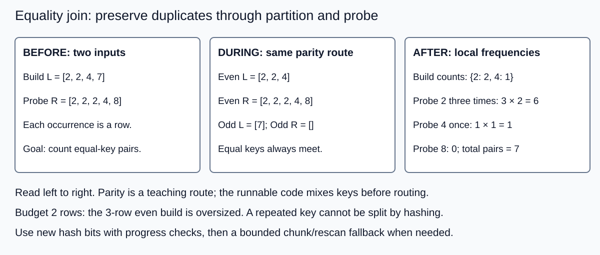

# Hash joins, recursive partitioning, and spill

Count inner equality pairs of non-null u64 keys, preserving duplicate occurrences.
For key k, pair count is fL(k)*fR(k). The running example L=[2, 2, 4, 7],
R=[2, 2, 2, 4, 8] has 2*3+1*1=7 pairs. Payload-producing joins require a separate
output contract and storage budget.



Read left to right. Parity is illustrative; the code mixes keys before routing.
The visual shows equal-key placement and why a row cap can require fallback.

## Implemented portfolio

- `nested`: independent quadratic oracle on bounded tests.
- `hash`: standard randomized HashMap of key frequencies, then probe.
- `merge`: copy, sort and count equal runs.
- `partition`: resident 16-way routing of both inputs, then local hash joins.
- `chunk`: at most B build rows per table, repeated full probe scans.
- `spill`: headerless little-endian file keys, recursive four-way paired
  partition, fresh two-bit digits, depth/no-progress guards and chunk fallback.

For n build and m probe rows, nested work is n*m. Expected hash work is n+m.
Our example gives 20 versus 9. Sorting plus merge has model
n*log2(n)+m*log2(m)+n+m, about 28.6 model units here, not actual comparisons.
Chunk work is n+ceil(n/B)*m: B=2 gives 14 visits. Resident partition adds
routing and retained copies. It has no hard memory limit.

An ideal one-level Grace input-read/write/reload model is 3*(SL+SR), with SL/SR
in consistent pages or bytes. Using 9 eight-byte records gives 27 record units
or 216 bytes, excluding output/slack/recursion. Hybrid saves the retained paired
fraction's write and reread: 3*(SL+SR)-2*(SL0+SR0). For retained combined fraction
f this is (3-2*f)*(SL+SR); f=1/9 gives 25 record units. Hybrid is teaching scope,
not an implemented measured candidate. The spill runner's actual logical counts
can differ because empty pairs are skipped and fallback rescans add reads.

## Contracts and boundaries

Frequency counting is sufficient for pure equality pair count. It cannot replace
an arbitrary join with payload output or an extra per-pair predicate. Count uses
u128; occurrence frequencies use u64. The supported 64-bit targets' slice sizes
keep these totals representable. Equal keys route identically on both sides;
colliding unequal keys still need exact comparison. Recursion checks largest
child size and uses fresh digits. One equal-key group cannot be split by key
hashing; the fallback preserves each pair once.

The spill budget caps build input rows. It does not meter allocator bytes,
HashMap spare capacity, I/O buffers, parent files, descriptors, disk space, output
or total process memory. Files belong to a caller-owned unique scratch directory;
creation refuses overwrite, truncated records/error paths propagate errors and
files remain for caller retention/cleanup. This is temporary query replay, not
crash recovery, fsync durability or a transactional spill format. The tests remove
their owned directories after success. Real admission must account all resources.

## Run

```sh
cargo test -p hash-joins
cargo run -p hash-joins --example demo
python3 topics/018-hash-joins-partitioning-and-spill/measurements/runner.py --out /tmp/topic018-fresh
```

The demo prints pairs=7 and logical spill counters. Use a fresh output path.
Selection/results and exact artifact identities are in measurements/README.md.

## Selection and revisit

For tiny inputs, compare the allocation-free nested reference as well. Its bounded
reference contest with merge is unresolved under the declared criterion.
Start with hash for a general resident baseline. Use merge where controlled
measurements support it. Admit partitioning only when its extra routing buys
measured benefit. Use paired file partitions for an oversized admitted build
state and bound recursive depth/work with a complete fallback.

The catalog/index gives this topic no extra coverage array. Explicit revisits:
hybrid implementation, true byte admission, wider payload/row-ID output,
outer/null/custom equality contracts, adaptive fanout, heavy-key product tiling,
parallel ownership, cancellation/partial I/O injection, cold-device throughput,
spill-disk quotas, durable spill/recovery and production-engine comparisons.

## Primary sources

- [DeWitt and Gerber 1985](https://www.vldb.org/conf/1985/P151.PDF): Grace/hybrid design.
- [PostgreSQL 18 executor source](https://github.com/postgres/postgres/blob/REL_18_STABLE/src/backend/executor/nodeHashjoin.c): hybrid batches/growth escape.
- [PostgreSQL 18 resources](https://www.postgresql.org/docs/18/runtime-config-resource.html): operator hash memory configuration.
- [DuckDB memory management](https://duckdb.org/2024/07/09/memory-management): broader spill/buffer accounting.
