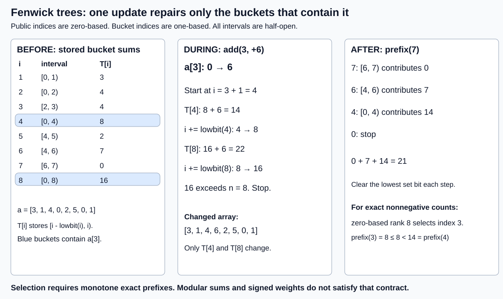

# Fenwick trees

Maintain a fixed indexed array with interleaved point additions and half-open
range sums. Start with a scan; compare a prefix array, Fenwick and segment tree
from query width, update mix and construction amortization.



Public indices are zero-based; buckets are one-based. Bucket `i` stores
`[i-lowbit(i), i)`, with `lowbit(i) = i & -i` in unsigned wrapping arithmetic.
A query clears the endpoint's lowest set bit. An update starts at `p+1` and adds
its lowbit until it exceeds the logical length. For
`[3,1,4,0,2,5,0,1]`, adding six at index three repairs buckets four and eight.
Then `prefix(7) = T[7]+T[6]+T[4] = 0+7+14 = 21`, and `range(2,7)=21-4=17`.

## Contracts and arithmetic

`Fenwick` uses u64 sums modulo 2^64, in every build mode. Empty ranges and
`prefix(len)` are valid; reversed/out-of-range endpoints panic before mutation.
`Counts` separately admits nonnegative counts with a checked u64 total. It
returns the index containing a zero-based rank, or None at/above the total.
Rejected count replacements leave state unchanged. Zeros use the `<=` skip
comparison. Signed leaves or wrapped totals invalidate monotone selection.

Ordinary point-delta propagation relies on commutative addition; range
cancellation also uses an inverse. Arbitrary associative aggregates, order-sensitive
combinations and arbitrary minimum replacement need another contract, commonly
a segment tree. Assignments need the old value to compute the delta. Fixed
coordinate compression needs rank repair/rebuild when new keys alter positions.
The structures provide no concurrent-operation protocol.

`RangeAdd` maintains difference and index-weighted difference trees. For
`D[j] = a[j]-a[j-1]` (a[-1]=0), `P(x)=x*sum(j<x)D[j]-sum(j<x)j*D[j]`.
A range addition emits +d at l and -d at r; boundary n needs no stored event.
With l=3,r=4,d=6,x=7, the two sums are 0 and -6, so P(7) increases by 6.
Products wrap by contract. Exact arithmetic would require checked intermediates.

## Costs and alternatives

Let n be length, h=floor(log2(n))+1 for positive n, U updates, Q queries,
L mean range length and S mean repaired suffix length. Scan work is O(U+QL),
prefix-array work O(US+Q), and Fenwick/segment work O((U+Q)h).
For n=8,U=Q=1 with `add(3, d)` then `prefix(7)` (the range `[0, 7)`): scan
reads seven values, prefix repair changes five slots (indices 4 through 8), and
Fenwick repairs two buckets (4 and 8) and reads three (7, 6, 4). `prefix(r)` reads
exactly popcount(r) buckets. Build forwards each completed bucket once: O(n).
Repeated point insertion takes O(n log n). Direct count lifting takes O(log n);
binary-searching repeated prefix queries takes O(log squared n).

Fenwick stores n+1 sum slots; scan n; prefix n+1; the implemented segment tree
2b, where b is the next power of two at least max(1,n). For n=8 these are
9,8,9,16 slots. Count selection additionally retains n original leaves. Include
allocator slack, caller inputs and build overlap in a physical budget.

Choose scans for tiny/narrow/short-lived cases, prefix arrays for immutable
batches, Fenwick for mutable broad sums, and segment trees for a richer aggregate
contract. See [measured selection](measurements/README.md),
[protocol](BENCHMARK.md) and [test strategy](TEST_STRATEGY.md).

## Run

```sh
cargo test -p fenwick-trees
cargo bench -p fenwick-trees --bench portfolio -- fenwick mixed
cd topics/019-fenwick-trees
python3 runner.py
```

The runner requires Linux, rustc, Python 3.9+, lscpu and objdump. It compiles
and runs the unit and integration tests, then records 256 candidate processes
and 128 identical-artifact control processes, input identities, every attempt
including failures and timeouts, environment, linked-image hash, linked
disassembly and descriptive paired summaries under ignored `raw/`.

## Primary sources and revisit scope

- [AtCoder v1.6 source](https://github.com/atcoder/ac-library/blob/v1.6/atcoder/fenwicktree.hpp): point-add and half-open modular sum mechanics.
- [AtCoder contract](https://atcoder.github.io/ac-library/production/document_en/fenwicktree.html): accepted endpoints and integer arithmetic.
- [Fenwick frequency-to-symbol report](https://www.cs.auckland.ac.nz/~peter-f/FTPfiles/TechRep110.pdf): cumulative-frequency search and indexing conventions.

Linear construction, checked selection and two-tree formulas are derivations
validated by finite independent-array checks here. Catalog Topic019 names Fenwick
trees without extra named variants. Revisit multidimensional/sparse/compressed
coordinates, dynamic keys, assignment APIs, exact checked range arithmetic,
concurrent operation consistency, matched selection benchmarks and cold/tail behavior.
