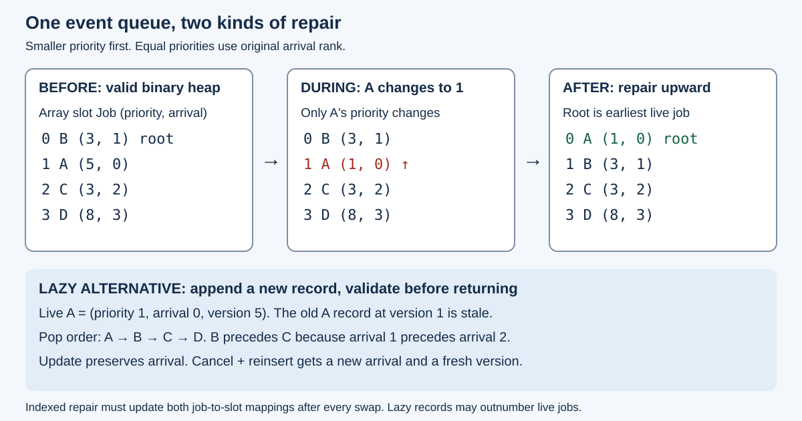

# Heaps and priority queues

Return the smallest `(priority, original_arrival, id)` live record. Updating a live
ID preserves arrival; cancellation followed by insertion assigns a fresh arrival.
IDs belong to one fixed universe. Every successful set gets a fresh validation
stamp. Invalid IDs and counter exhaustion reject before mutation. Allocation
failure follows ordinary Rust allocation policy. The queue is sequential.



## Run

```sh
cargo run -p topic021-heaps-and-priority-queues --example schedule
cargo test -p topic021-heaps-and-priority-queues
cd topics/021-heaps-and-priority-queues
rustc --edition=2024 -C opt-level=3 -C target-cpu=native benches/priority.rs -o /tmp/topic021-bench
/tmp/topic021-bench four mixed
python3 scripts/run.py /tmp/topic021-runs
```

Expected example: `pop order: A B C D`. Each direct benchmark invocation checks
all returned records and final state before warmup, then emits one JSON row.
Default invocation uses `four tiny`. The Python runner records metadata, exact
file/binary hashes, process attempts, schedule, tests and paired summaries.

## Candidates and costs

The scan stores authoritative slots and scans the entire ID universe. Indexed
binary, four-child and eight-child heaps own all swaps and repair ID-to-position
maps. `binary_push` differs only in initial construction. Lazy candidates use
standard `BinaryHeap<Reverse<Entry>>`, retaining old versions until validated
away. `compact` additionally rebuilds after mutations when `H > 2L + 32`.

Let `U` be the ID universe, `L` live records, `H` physical lazy records, `d` fanout
and `s` stale records discarded before a logical pop. Comparison and record
movement are assumed constant-cost. Scan updates/cancels cost O(1), minimum
lookup O(U). Indexed upward repair costs O(log_d(L+1)); downward repair and
arbitrary deletion cost O(d log_d(L+1)). Increasing a min-heap key can move down.
Resizing is separate. Fixed-d bottom-up heap construction costs O(L), versus
O(L log(L+1)) worst-case repeated insertion. Favorable insertion orders can be
linear. Standard growing-push guarantees differ from a worst-case per-call bound.

For four jobs, changing A from `(5,0)` to `(1,0)` at binary slot1 compares against
parent `(1-1)/2=0` and swaps with B. Binary/four-child height estimates are
log_2(4)=2 and log_4(4)=1. At 65,536 jobs these estimates are16 and8; eight-child
has about6 levels. Wider child scans can offset fewer levels.

Lazy pop has an O((s+1) log(H+1)) upper-bound model. Updating one of four jobs
leaves H=5,L=4. Rebuild threshold2*4+32=40 is a count policy. An authoritative
rebuild scans U slots and heapifies L records; include old storage release and
old/new overlap. The threshold bounds completed-operation record counts, while
capacity, allocation bytes and worst-call latency need separate evidence.

The teaching implementation retains an authoritative slot array for all
candidates. Its extra universe state is part of the measured design. `Entry`
contains four machine/u64 words on these 64-bit hosts. This is a record-width
observation, not a measured process-memory budget. Sparse-ID maps and large
payload indirection require separate tests and accounting.

## Correctness and selection

The oracle uses separate ordered maps/sets and its own counters. Tests cover
all 7^5 length-five traces over seven operations for two IDs, every transition's
state, FIFO update/reinsertion, same-key stale records, zero/one/partial child
groups, increase/decrease, last deletion, invalid IDs, counter exhaustion and
compaction. Sampled benchmark traces additionally check every popped record,
final live snapshot and representation invariants. These bounds establish
sequential tested behavior, not general proof or concurrent safety.

See [measurements](measurements/README.md) for host-specific results and limits.
Use a scan for update-dominated workloads with rare minimum extraction. Measure
binary/four/eight indexed candidates for keyed churn. Lazy invalidation trades
repair for physical records and future cleanup. Choose a maintenance budget
before using compaction. Bulk construction plus a first peek and a full drain
are different operations; this experiment measures the former.

Catalog coverage: binary/d-ary heaps, indexed updates, bulk construction, lazy
invalidation and FIFO ties are implemented. Revisit: sparse IDs, large payloads,
meldable heaps, decrease-key-only workloads, bounded maintenance, concurrency,
cold-cache and tail latency. Timer clocks/wheels remain Topic049; graph-specific
queues remain Topic031; rank/Top-K remains Topic008.

## Primary sources

- [Rust BinaryHeap](https://doc.rust-lang.org/std/collections/struct.BinaryHeap.html),
  with [1.98.1 source](https://github.com/rust-lang/rust/blob/1.98.1/library/alloc/src/collections/binary_heap/mod.rs)
  and [1.99.0 source](https://github.com/rust-lang/rust/blob/1.99.0/library/alloc/src/collections/binary_heap/mod.rs).
- [Go heap Fix/Remove](https://pkg.go.dev/container/heap): indexed repair and
  update directions. Our representation and bounds are explicit derivations.
- [Python3.14 priority-queue notes](https://docs.python.org/3.14/library/heapq.html#priority-queue-implementation-notes):
  tie count and lazy removal. Its replacement recipe renews tie count; this lab
  explicitly preserves birth on an update.
