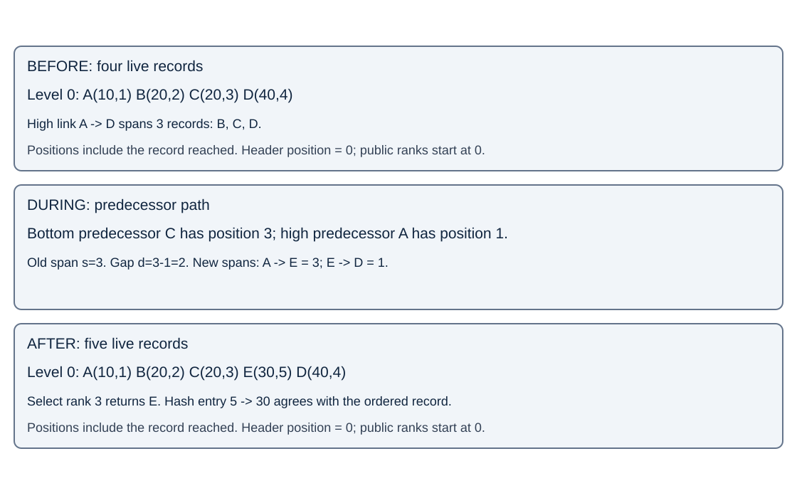

# Skip lists and hybrid ordered indexes

A changing leaderboard needs member lookup, sorted ranges and exact ranks.
This sequential experiment compares a sorted vector, standard B-tree set and
ranked skip list. All three retain a member-to-score hash map.

## Contract

Order integer records by `(score: i64, member: u64)` ascending. Members are
unique; equal scores order by member ID. `put` replaces a score, deletion
returns existence, and absent queries return `None`. Rank and selection are
zero-based. `range(low, limit)` returns up to `limit` records with score >= low.
Zero limit and invalid selection are empty. There is no external arena handle,
concurrent access, recoverable allocation failure or unwind-rollback contract.

Both views contain exactly the same members and scores. Upsert removes the old
ordered tuple before inserting its replacement. A known member is not a known
predecessor path; hash lookup alone does not make ordered deletion constant time.

## Span invariant



A(10,1), B(20,2), C(20,3), D(40,4) receive E(30,5). Internal positions use a
header at zero. A high A->D edge spans 3. Bottom predecessor C has position 3;
high predecessor A has position 1. Gap d=3-1=2 splits old span s=3 into d+1=3
and s-d=1. Other crossing levels increment even if E has no link there.

For a real destination, `span(u,v)=position(v)-position(u)`. A terminal edge
has `n-position(u)`; missing successors are never followed. This differs from
Pugh's terminal at n+1. Deletion joins direct edges as `left+victim-1`; crossing
edges decrement by one. Sorted traversal alone cannot check those counts.
`validate` reconstructs positions independently from bottom traversal and checks
all active spans, membership, strict order, reachability and recycled slots.

## Mechanisms and costs

With n live fixed-width records and q returned records:

- Flat: hash lookup, binary rank search, constant indexed selection; mutation
  can move n records; score range costs O(log n+q). E moves only D here.
- Tree: hash lookup, O(log n) ordered mutation/range seek. This standard-set
  adapter computes rank with `range(..key).count()` and selection with iterator
  `nth`, so visited records can be linear. E selection visits four records.
- Skip: hash lookup plus expected O(log n) ordered operations under suitable
  independent randomized levels/capacity assumptions; ranges add q visits.
  Every active level needs mutation accounting, including crossing edges.

For independent promotion probability p=1/4 and cap M=24, expected logical
links per data node are `(1-p^M)/(1-p)`, nearly 4/3; five nodes give about 6.67.
This is not allocated bytes. Our private arena reuses fully unlinked slots but
retains peak slots/capacity; each live node has a link Vec. Terminal nodes,
header, hash capacity, allocator overhead and output also consume storage.
A fixed cap eventually loses logarithmic scaling; the worst case is linear.
The deterministic nonzero xorshift64 generator is a replay device, not a proof
of independent randomness, collision resistance or an adversarial bound.

The source uses exclusive mutation, owned integer keys and private indices.
Atomic links would not establish consistent ranks or two-index transactions.
Concurrency, floating scores, arbitrary member strings, compact encodings,
augmented balanced trees, fingers, split/merge and reverse iteration are revisit
scope. Catalog coverage here: randomized skip lists, rank spans, combined hash
and ordered indexes. Redis layout and speed are not measured by this code.

## Run

```bash
cargo run -p topic022-skip-lists-and-hybrid-indexes --example leaderboard
cargo test -p topic022-skip-lists-and-hybrid-indexes --all-targets
python3 topics/022-skip-lists-and-hybrid-indexes/scripts/run.py /tmp/topic022-results
```

The example prints `[(10, 1), (30, 5), (40, 4), (50, 2)]` after insertion,
score replacement and deletion. The runner requires Linux, rustc and Python3.9+.
It compiles native candidates and runs independent oracle checks before timing.
Read BENCHMARK.md for boundaries and measurements/README.md for results.
Choose compact vectors for measured read/movement tradeoffs, standard trees for
ordered updates with acceptable rank traversal, and ranked structures when
maintained counts earn their mutation and storage costs.

## Primary sources

- [Pugh, Cookbook, revised June1990, section3.4 and Figs10-11](https://api.drum.lib.umd.edu/server/api/core/bitstreams/17176ef8-8330-4a6c-8b75-4cd18c570bec/content).
- [Redis8.2.0 span and score repair](https://github.com/redis/redis/blob/4fa8bf356b4bf0f1ce345286a4f02d022a4badcb/src/t_zset.c#L119-L290).
- [Rust1.99.0 BTreeSet](https://github.com/rust-lang/rust/blob/1.99.0/library/alloc/src/collections/btree/set.rs).

Equations and candidate contracts are explicit derivations. Source facts do not
establish measured speed, concurrent correctness or process-memory bounds.
