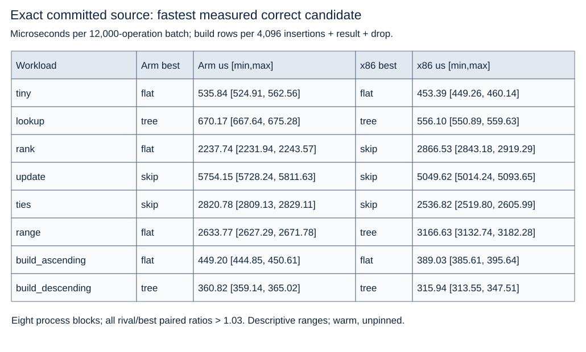

# Exact-source measurements

Both initial and committed campaigns ran320 fresh processes per required Linux
host,1280total. All oracle responses/final states, tests and transferred source
hashes pass. Source commit `bf6504d022008ef8db065152c07d122e0604b4eb`; the receipt's three source
hashes identify that commit. Later review-fix commits touch only `cargo bench`
argument filtering, `Skip::validate` assertions, and runner bookkeeping (test
execution, hashing, timeouts, checksum check); measured operation paths are unchanged. Full host/toolchain/features/affinity,
all candidate medians/ranges, paired ratios and A/A are in EVIDENCE_RECEIPT.json.
Raw attempts/schedules/metadata/tests/binaries/source tar are retained outside
Git at `/Users/ahrav/.codex/automations/algorithms-daily-curriculum/evidence/topic-022/20261018` under initial/ and committed/.

Time unit: microseconds per12000-operation batch, or4096incremental insertions
plus first20result/fold/drop in build cells. Every cell resolves under the
predeclared all-eight-pairs>1.03 rule. Initial selections are identical.

| Workload | Arm best | Arm us [min,max] | x86 best | x86 us [min,max] |
|---|---|---|---|---|
| tiny | flat | 535.84 [524.91, 562.56] | flat | 453.39 [449.26, 460.14] |
| lookup | tree | 670.17 [667.64, 675.28] | tree | 556.10 [550.89, 559.63] |
| rank | flat | 2237.74 [2231.94, 2243.57] | skip | 2866.53 [2843.18, 2919.29] |
| update | skip | 5754.15 [5728.24, 5811.63] | skip | 5049.62 [5014.24, 5093.65] |
| ties | skip | 2820.78 [2809.13, 2829.11] | skip | 2536.82 [2519.80, 2605.99] |
| range | flat | 2633.77 [2627.29, 2671.78] | tree | 3166.63 [3132.74, 3182.28] |
| build_ascending | flat | 449.20 [444.85, 450.61] | flat | 389.03 [385.61, 395.64] |
| build_descending | tree | 360.82 [359.14, 365.02] | tree | 315.94 [313.55, 347.51] |

Select skip for update-heavy and equal-score mixes on both hosts; flat for tiny
and ascending construction; tree for lookup-heavy and descending construction.
Arm rank/range choose flat; x86 rank chooses skip and range chooses tree.
These are host/workload winners among the three measured implementations.
Incremental vector construction is not a bulk-sort builder comparison.

A/A paired ratios range0.9354..1.0328 on Arm tiny and0.9587..1.1309 on x86rank;
all A/A medians remain near1. No sample exclusion or extra winner-seeking run.
The descriptive rule is not an inferential confidence/significance claim.
Native-copy/hash/allocator/toolchain differences are possible explanations;
none was isolated with generated-code or candidate-only counters.
Steady timing includes output allocation/dispatch/hash work, excludes setup and
destruction. Build timing includes destruction. No cold-device/cache, tail,
production Redis, allocator-byte/RSS, ISA-only or universal-optimum claim.

## Allocation and linked-code diagnostics

Separate instrumented copies retain48processes across both hosts/all8cells and
all3candidates, with3within-process count samples. Every preflight oracle passes;
underlying lib.rs hash equals the committed source. A standalone allocator
forwarding adapter counts alloc/alloc_zeroed calls, realloc calls and cumulative
requested bytes only inside the declared consumer boundary, including output.
The adapter exists only in external diagnostic scratch. Counts are not live,
peak or RSS bytes; instrumentation changes overhead, so its times do not select
winners. Source/runner/archive/identities and full counts are retained under
`/Users/ahrav/.codex/automations/algorithms-daily-curriculum/evidence/topic-022/20261018/allocation`; compact results are in the receipt.

For example, on each host the update cell records flat3322alloc/0realloc,
tree4003/0 and skip11723/5 per batch. Skip still wins the original timing cell.
The range cell records flat10800/1, tree10924/32355 and skip12001/32355;
output materialization is a deciding cost, not an isolated search benchmark.
Three within-process observations are descriptive counts, not three independent
process replications. Build requested-byte totals differ by host; no ISA-only
cause is inferred.

Exact campaign binaries were disassembled with llvm-objdump. Flat selection
performs a bounds check followed by an indexed16-byte load on both targets;
flat put, tree select and skip select remain distinct linked methods. Extracts
and original output are retained under `/Users/ahrav/.codex/automations/algorithms-daily-curriculum/evidence/topic-022/20261018/inspection`.
Static code supports the mechanism's presence, not attribution of elapsed time.
