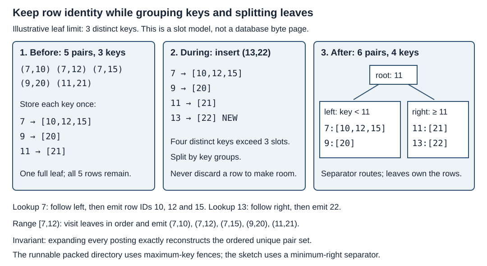

# B-trees and posting-list deduplication

Find a key without losing its rows. Contract: an ordered set of `(u64 key,
u64 row_id)` pairs; identical pairs are idempotent, different row IDs survive.
Ranges are half-open `[low,high)`; low >= high is empty. A high bound of
`u64::MAX` excludes that key. No concurrent, persistent, fallible-allocation,
collation, multiset, or snapshot-visibility contract is implemented.



The illustrative three-key leaf groups five pairs, overflows on `(13,22)`,
then splits into two leaves. Root separator11 uses minimum-right routing.
The executable packed directory instead uses maximum-child fences: choose the
first child with `max >= low`, then search its leaf. Boundary conventions
must not be mixed. Rendering inspected; white background and explicit labels.

## Alternatives and costs

- Flat sorted unique pairs: binary-search boundaries and contiguous copying;
  mutation shifts a suffix. Baseline for snapshots and broad results.
- `BTreeSet<(key,row)>`: mutable pair order, repeated keys, node maintenance.
- `BTreeMap<key,Vec<row>>`: one key and all sorted distinct row IDs; inserting
  into a long posting can move many IDs. Delete one ID; remove only empty keys.
- Packed8/32: immutable bulk-built B+ directories over groups and contiguous
  rows. Slots bound key/child counts, not bytes. A huge posting is not bounded
  by fanout. Updating requires rebuilding; it has no online split/merge code.

Let n be unique pairs, u unique keys, k key bytes, r row-ID bytes, and h extra
posting descriptor bytes. Flat payload n(k+r); grouped payload u(k+h)+nr.
Grouping saves modeled payload only when (n-u)k > uh, excluding directories,
headers and allocator slack. With six pairs/four keys/k=r=8/h=16:96 flat vs144
packed-group bytes before directory. At32768pairs/128keys:524288 vs265216.
For this implementation logical_bytes explicitly models group and fence bytes;
it is not allocation count, total reserved capacity or resident memory.

With leaf capacity b and fanout f, L=ceil(u/b) leaves and roughly ceil(log_f L)
directory levels plus a leaf visit. The running example u4/b3/f2 gives two
leaves and one root. Point/range materialization costs O(log u+z) for a posting
tree, where z returned pairs must still be copied. Key7 returns three rows.
A posting of m row IDs has O(log m) search and O(m) shifts on insertion; adding11
to[10,12,15] moves12and15. Directory navigation alone is not operation cost.

Bulk construction sorts and deduplicates arbitrary pairs, groups equal keys,
and builds balanced directory levels bottom-up. Last groups may be short;
this is not the occupancy contract of a fully mutable textbook tree.

## Run

```bash
cargo test -p topic023-b-trees-and-posting-list-deduplication
cargo run -p topic023-b-trees-and-posting-list-deduplication --example demo
python3 topics/023-b-trees-and-posting-list-deduplication/scripts/run.py /tmp/topic023-results
```

Demo returns `(7,10),(7,12),(7,15),(9,20),(11,21)`. See BENCHMARK.md and
measurements/README.md for measured selections. Keep output, build and teardown
inside the applicable boundary. A smaller encoded tree need not be faster.

## Production boundaries and revisit

Integer equality here implies interchangeable key representation. PostgreSQL18
requires a separate equalimage safety condition; INCLUDE indexes cannot dedup.
Do not infer database uniqueness or row visibility from a posting. Database
B-tree row identifiers refer to row versions. The toy has no heap or visibility.
Revisit byte-bounded leaves, oversized postings, online splits/merges, recovery,
concurrent lifetime, collation and database-specific eligibility separately.
Catalog023 has no additional named coverage array; ALGORITHM_INDEX assigns
B-trees and posting-list deduplication to this owner.

## Primary sources

- [External-memory B-tree mechanics](https://opendatastructures.org/ods-cpp/14_2_B_Trees.html)
- [Rust BTreeMap API and implementation discussion](https://doc.rust-lang.org/std/collections/struct.BTreeMap.html)
- [PostgreSQL18 deduplication and equalimage](https://www.postgresql.org/docs/18/btree.html)
