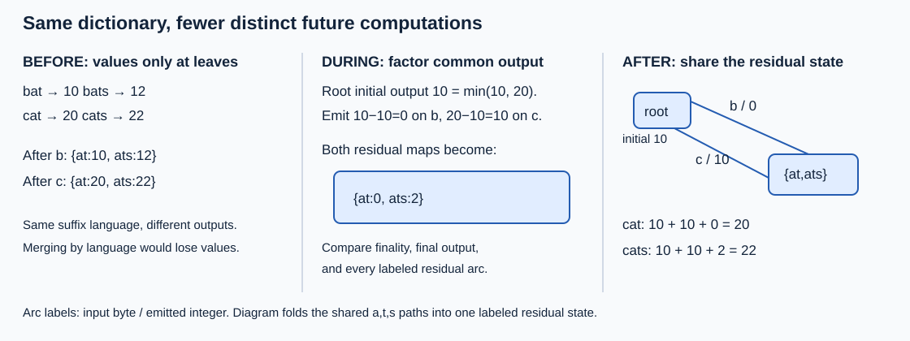

# Finite-state transducers and compact dictionaries

Store an immutable raw-byte-to-u64 dictionary with exact lookup and sorted prefix output.
The baseline sorted vector shares no key storage. A byte trie shares prefixes; final-output
interning shares equal full suffix mappings; minimum-output pushing exposes equal residual
mappings before exact signature interning. A hash-map/filter/sort oracle shares no graph logic.

Contract: arbitrary input order, empty/binary keys, length at most64 bytes, last input duplicate
wins, full u64 values. Construction rejects any longer key. There is no mutation or decoder.
`None` and `Some(0)` final outputs differ. Graph traversal must consume the complete key and
end at an accepting state. Enumeration follows every incoming path through shared states.

For bat10/bats12/cat20/cats22, the trie has9 states/8 arcs; pushing yields5 states/5 arcs.
The root initial output is10, b/c arcs emit0/10, and the common at/ats residual outputs are0/2.
Thus cats returns10+10+2=22. Never merge states merely because their accepted suffixes match.



For each trie state q, p(q) is its minimum complete descendant output. Final residual is
value-p(q); edge q->c emits p(c)-p(q). Each accepted path telescopes to its original value.
Children are canonical before interning `(terminal, [(byte,residual,canonical_child)])`.
HashMap compares full signatures after hashes; the complete registry is dropped after build.
The empty dictionary retains a rejecting root. All constructed nonempty branches reach a key.

Lookup consumes m bytes and binary-searches fanout d_i at each visited state: work is
sum_i O(log(d_i+1)) plus target/output loads, checked addition, and acceptance. For cats,
m=4 and fanouts2,1,1,1. An early miss stops sooner. Prefix emission costs at least its
returned bytes and values. State count is not latency or physical image size.
Retained heap capacity = state-vector capacity*sizeof(Node) + arc-vector capacities*sizeof(arc).
For the example, S=5,A=5; capacities and allocator overhead are separate. Construction also
holds normalized records, full trie, registry and result; it is not a bounded-memory builder.

An FST build costs R extra nanoseconds and saves delta per query only if Q*delta>R, where Q is
queries before rebuild. For illustrative R=1ms,delta=50ns, Q must exceed20,000. These numbers
are arithmetic examples, not measurements. Frequent updates can erase the savings.

Run from repository root:

```sh
cargo test -p topic025-finite-state-transducers
cargo run -p topic025-finite-state-transducers --example dictionary
cargo bench -p topic025-finite-state-transducers --bench portfolio -- pushed shared
```

On Linux, `cd topics/025-finite-state-transducers && python3 run.py` runs the frozen campaign.
See BENCHMARK.md and measurements/README.md for controls, outcomes and evidence identities.
Choose a vector when simplicity/build/output costs dominate. Choose a pushed graph only when
measured query and space benefits justify construction and immutable rebuilds. A mutable trie
or overlay solves another update contract. This scalar model is neither fst's byte format nor
a production mmap implementation. Cold/large-state/tail behavior remains unmeasured.

Coverage: the catalog has no separate Topic025 variants. This round implements unsigned-additive
output pushing and exact batch residual interning. Revisit sorted streaming/external-memory
construction, string-output algebras, packed serialization/validation, mmap cold startup,
automaton intersection/fuzzy queries, and mutable-overlay compaction. No silent universal
minimality, suffix-query, or production-library performance claim.

Sources: [Daciuk et al.2000](https://aclanthology.org/J00-1002/),
[Mohri1997](https://aclanthology.org/J97-2003/),
[fst0.4.7 builder](https://github.com/BurntSushi/fst/blob/0.4.7/src/raw/build.rs),
[fst0.4.7 node](https://github.com/BurntSushi/fst/blob/0.4.7/src/raw/node.rs).
Sortedness is that streaming builder's precondition, not a batch minimization theorem;
its bounded registry does not establish exact-minimality. This model uses binary arc search.
