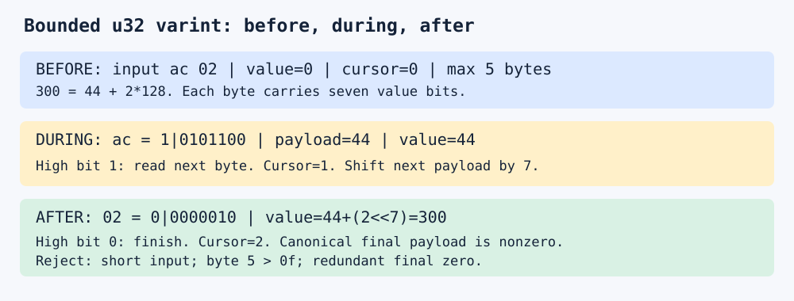

# Varints, codecs, and bounded decoding

Store small unsigned integers compactly while bounding input reads and output count.
The running values `[1,127,128,300,4294967295]` occupy 11 canonical varint bytes or
20 little-endian fixed-width bytes. For 300, `ac 02` carries payloads 44 and 2:
`44 + 2*128 = 300`. Each high bit indicates continuation.



## Contract

`scalar` and `unrolled` decode complete buffers of shortest-form unsigned u32 varints.
Each integer uses at most five bytes. Byte five must be at most `0x0f`.
A multibyte integer must have a nonzero final payload. The caller supplies a maximum
output count. Count is checked before reading another integer. Empty input succeeds.
Errors contain the integer's starting byte offset and truncation, overflow,
noncanonical, or limit kind. Output is cleared on entry; errors retain the valid prefix.
Callers must check the Result before using that prefix. Safe checked loads enforce tails.

`fixed` uses four-byte little-endian integers and the same count/prefix rules.
The public functions may allocate as output grows. The limit bounds element count;
allocation overhead and capacity rounding require separate application budgeting.
The experiment reserves exact workload capacity before timing.

## Alternatives and cost

The scalar loop is the reference starting point. The unrolled implementation expands
five checked byte positions for the same wire format and errors. Fixed width provides
regular positions with four bytes per value. Measure both time and representation size.

Let x be a value and b(x) its bit length, defining b(0)=1. Then L(x)=ceil(b(x)/7)
encoded bytes. For 300, ceil(9/7)=2. For N values, B=sum L(x[i]); the example gives
N=5 and B=11, versus 4N=20 fixed-width bytes. Valid scalar work is O(B+N), with N
output writes. A count limit M bounds varint reads by 5M; M=5 permits at most 25
reads and 20 output payload bytes. Metadata and allocator costs are additional.

ZigZag maps signed values near zero to small unsigned values. For i32 x,
`((x as u32)<<1)^((x>>31) as u32)` maps -2 to 3. Signed LEB128 instead has signed
termination/sign-extension rules. This crate implements the unsigned contract.
WebAssembly accepts some redundant LEB128 forms. Its acceptance rules differ from ours.

## Run

```bash
cargo test -p topic044 --all-targets
cargo run --release -p topic044 --example experiment -- example
cd topics/044-varints-codecs-and-bounded-decoding/measurements
python3 run.py
```

The runner supports its repository layout and the standalone replay layout.
It prints an external evidence directory containing raw samples and environment identity.
See BENCHMARK.md and measurements/README.md for the frozen schedule and obtained results.
`cargo bench -p topic044` runs a smoke of the running example and ignores arguments;
timed samples come from the experiment example, which the runner schedules.

## Selection and coverage

Start with scalar; justify unrolling through measured length distributions. Evaluate fixed
width when predictable access offsets and decode speed justify its bytes. Keep format,
width, canonicality, output-count and partial-write contracts explicit.
An oversized final payload defeats a length-only bound. Length prefixes require checked
arithmetic and resource admission. Wide loads require readable initialized tails.

Stream VByte separates control/data streams for bulk SIMD decoding; Masked VByte works
with interleaved continuation bits. Bit packing/FOR groups residuals at a shared width.
These require format-specific validation and tail rules. Revisit implementations,
SIMD dispatch/tails, signed LEB128/ZigZag interoperability, streaming split state,
random-access checkpoints, allocation-inclusive latency, cold caches and real corpora.
The catalog has no coverage arrays and ALGORITHM_INDEX.md is missing at this base.
This explicit scope preserves those variants pending catalog reconciliation.

## Primary sources

- https://protobuf.dev/programming-guides/encoding/ : seven-bit varints and ZigZag.
- https://webassembly.github.io/spec/core/binary/values.html : width and redundant forms.
- https://arxiv.org/abs/1709.08990 : Stream VByte control/data separation.
