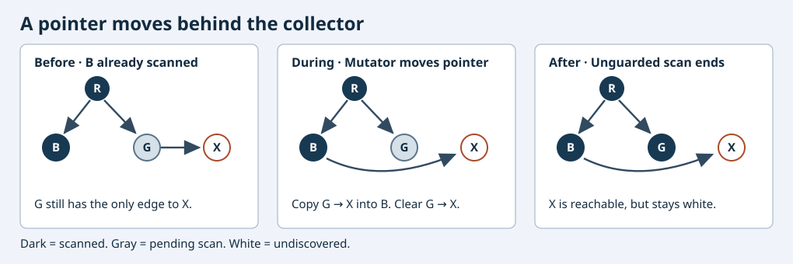

# Concurrent graph marking, write barriers, and work-list termination

A collector starts at roots and marks every object reachable through pointers.
While it scans, a program thread can move a pointer from an unscanned object into
one the collector already examined.



White means undiscovered. Gray means discovered with a scan owed. Black means
scanned. In the example, `R` reaches `B` and `G`. The collector already scanned
`B`. `G` points to `X`. The mutator copies that edge into `B` and clears it in
`G`. An unguarded scan of `G` leaves `X` white even though `R → B → X` exists.

| Policy | Per-write behavior | Contract at valid termination |
|---|---|---|
| Paused traversal | Mutations wait until marking finishes. | Exact reachable set of the fixed graph. |
| Insertion barrier | Shade the new target when the owner is black. | Every currently reachable node is scanned. |
| Snapshot-at-the-beginning deletion barrier | Shade the old target before replacing it. | Every node reachable at the start is scanned. |

Shade moves white to gray once. An insertion barrier preserves the invariant that
a black node has no edge to white. If all gray nodes are scanned, any path from
the root to white would cross a forbidden edge. For snapshot marking, an edge
that initially led to a still-white node cannot have been overwritten. Its old
target would have been shaded. The whole initial reachable set is protected
even if a node loses its last current incoming edge.

Use the paused baseline if the whole traversal fits the pause budget. Choose
the barrier after specifying which live set must be retained. The two contracts
can admit different amounts of extra retention. This model limits pointer
targets to nodes reachable before the write and models no allocation, so the
current live set is always a subset of the initial one.

Termination must account for shared work, buffered discoveries and a worker
holding an item. After scanning the example root, these counts can be
`0 + 2 + 0 = 2`. A real collector must coordinate the final check with work
producers. A transfer between queues can invalidate independently sampled zeros.

The marking work is O(V + E + W), with V scanned nodes, E inspected pointer
slots and W barriered writes. At four nodes with two slots each and two writes,
there are at most four scans, eight slot reads and two write-barrier steps.
The checker visits many combinations of these steps. Its runtime measures
the checker, so it cannot compare real collector pauses.

```sh
cargo run -q -p concurrent-graph-marking
cargo test -p concurrent-graph-marking
```

The model enumerates three fixed four-node heaps with up to two writes and
checks reachability independently via transitive closure. It treats scan and
barrier-plus-store as atomic steps. Real allocation, root mutation, weak
memory, handshakes, and barrier buffers require their own validation.

- [Dijkstra et al., On-the-Fly Garbage Collection](https://www.cs.utexas.edu/~EWD/transcriptions/EWD06xx/EWD630.html)
- [Yuasa, Real-time garbage collection on general-purpose machines](https://doi.org/10.1016/0164-1212(90)90084-Y)
- [Go design 17503, mark completion race](https://github.com/golang/proposal/blob/master/design/17503-eliminate-rescan.md#appendix-mark-completion-race)
