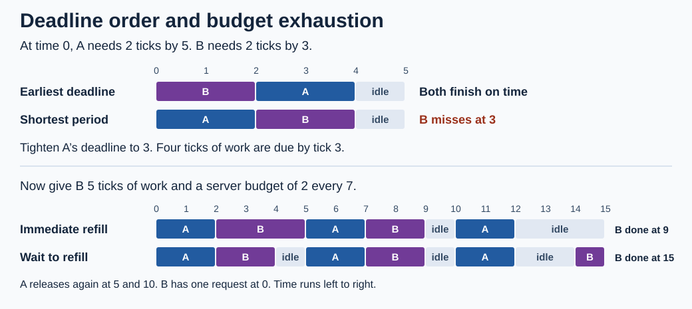

# Deadline scheduling: EDF, CBS, and admission control

One CPU must finish each job by its deadline. At time zero, A needs two ticks
by tick five. B needs two ticks by tick three. A repeats every five ticks and
B every seven. Both jobs can be paused and resumed at tick boundaries.



Earliest deadline first (EDF) runs B and then A. Rate-monotonic fixed priority
runs A first because it has the shorter period, and B misses. The simulator
continues late jobs and records misses at or before the requested horizon.

## Admission

For execution cost `C`, relative deadline `D`, and minimum release interval
`T`, a window of length `L < D` contains zero due jobs. Otherwise it can
contain `1 + floor((L - D) / T)` jobs, each of cost `C`. Sum across tasks.
The formula assumes independent preemptible tasks, one unit-speed CPU, and
`0 < D <= T`. A job finishing at its deadline meets it.

A and B use `2/5 + 2/7 = 24/35` of the CPU in the long run. Reducing A's deadline
to 3 leaves that fraction unchanged. At length 3, two jobs now require four
ticks. For implicit deadlines (`D = T`), the utilization condition suffices.
For constrained deadlines, check the windows.

The least common multiple of 5 and 7 is 35. Each additional 35 ticks adds
24 ticks of demand and 35 ticks of capacity. In general, extending by a
hyperperiod adds the same demand as the hyperperiod itself. A passing full
hyperperiod therefore covers all lengths. The probe cap bounds work. A violation
within the cap proves overload, and a short probe that passes is inconclusive.

The scanner uses O(`h*n`) task evaluations for `h` tested lengths and `n` tasks,
plus the greatest-common-divisor calculations. Here the full scan evaluates
35 × 2 task entries. The tick simulator also uses O(`s*j`) eligibility checks
for `s` slots and `j` submitted jobs, plus O(`s+j`) trace and job storage.
A two-job, five-slot simulation scans ten job entries. An event-driven scheduler
can use an ordered ready queue to skip idle runs and unchanged choices.

## Reservations

Give B one five-tick request and a constant bandwidth server (CBS) with a
budget of two ticks and a period of seven ticks. Its declared share is 2/7.
EDF compares the server's current scheduling deadline with each ordinary job's
deadline. The original CBS immediately restores the budget and advances its
deadline by seven at exhaustion. The fixed-boundary variant waits for the next
period and expires unused budget. With A released at 0, 5, and 10, the two
policies finish B at 9 and 15 respectively. Both meet A's deadlines.

The server model covers one continuously backlogged request and an implicit
server deadline. Real deployment also requires wakeup accounting, switching
costs, interrupt service, blocking, and the actual CPU admission domain.
A reserved request can miss its own deadline when its demand exceeds service.

## Reproduce

```sh
cargo run -p deadline-scheduling-and-admission-control --example deadline
cargo test -p deadline-scheduling-and-admission-control
```

Expect one fixed-priority miss, no EDF miss, a four-tick overload at length
three, and server completion at ticks 9 and 15. Tests exhaust small schedules,
enumerate periodic due jobs, and compare budget traces independently.

- [Liu and Layland, deadline-driven and rate-monotonic scheduling](https://igm.univ-mlv.fr/~masson/pdfANDps/liulayland73.pdf)
- [Baruah, Mok, and Rosier, processor demand for sporadic tasks](https://doi.org/10.1109/REAL.1990.128746)
- [Abeni and Buttazzo, Constant Bandwidth Server](https://www.cis.upenn.edu/~lee/01cis642/papers/AB98.pdf)
- [Linux deadline scheduling](https://docs.kernel.org/scheduler/sched-deadline.html)
