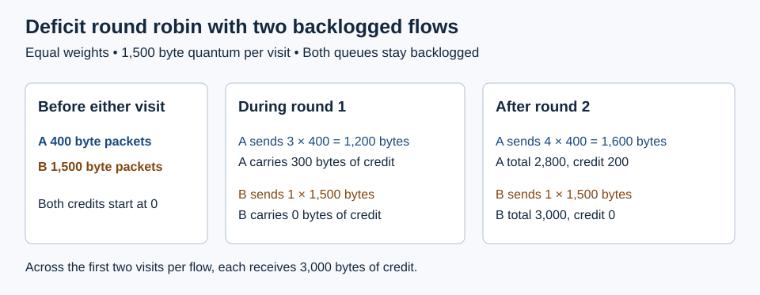

# Deficit round robin, fair queueing, and active queue management

A scheduler divides link service between flows. A queue manager signals
congestion when its queue persists. Track bytes for the first decision and
enqueue-to-dequeue time for the second.

## Contract

The scheduler drains a finite batch of already-arrived FIFO flow queues.
Packets have positive integral byte lengths, flows have positive integral
weights, and a link sends one whole packet at a time at one byte per tick. For
weighted fair queueing (WFQ), ties go to the lowest flow index. The fixed-arrival
queue exercise uses a FIFO (first-in, first-out) queue with a waiting-byte cap.
Arrivals at a service-start tick enqueue before selection. A separate teaching
controller marks a packet when consecutive high-sojourn dequeues span the
configured interval. Marked packets still consume link service.

## Policies

- Packet round robin sends one packet per active flow visit. Its cost is a
  constant amount of ring work per packet. Equal packet turns favor large packets
  in bytes.
- Deficit round robin (DRR) adds the flow's quantum per visit and debits bytes
  until the next head exceeds the balance. Leftover credit follows a backlogged
  flow into its next visit. An empty flow leaves the ring; a subsequent activation
  in a live scheduler would start with fresh credit. A quantum at least as large
  as that flow's largest packet guarantees a send on each fresh visit. Smaller
  quanta can require empty visits. Larger ones can increase service bursts.
- Weighted fair queueing uses cumulative bytes divided by weight as the ideal
  finish tag for this simultaneous batch. A binary heap maintains one head per
  active flow. A heap selection takes logarithmic work in active flow count.
  Staggered arrivals require virtual time at arrival. Generalized Processor
  Sharing (GPS) is the ideal weighted fluid link. The tests simulate actual
  simultaneous service independently and compare completed packet order and
  departure times.
- A queue cap limits memory and can drop arrivals even during a brief burst.
  Sojourn-based marking can signal a standing queue before a capacity drop. The
  teaching controller isolates the persistence rule. CoDel additionally accounts
  for remaining backlog and schedules drops or marks. FQ-CoDel combines
  CoDel and byte-based flow scheduling with new and old bucket lists.

In the figure, a 1,500-byte quantum gives the 400-byte flow 1,200 bytes on
its first visit and 1,600 on its second. The 1,500-byte flow receives
1,500 on each. While a flow stays backlogged, the difference between
credit granted and bytes sent equals its remaining credit. At tick 5,800,
GPS serves 2,900 bytes to each flow. Include partial packets when comparing
actual byte service at this common tick.



Use packet turns when packet costs match and packet service is the contract.
Use DRR for byte shares with inexpensive active-ring work. Use WFQ when
completion lag against ideal service justifies per-flow finish tags. Use
sojourn feedback when the queue must signal congestion. The open-loop replay
measures mark timing and service conservation. Closed-loop delay requires a
reacting sender.

```bash
cargo run -p deficit-round-robin-and-fair-queueing --example queues
cargo test -p deficit-round-robin-and-fair-queueing
bash topics/058-deficit-round-robin-and-fair-queueing/measurements/run.sh
```

## Sources

- [Shreedhar and Varghese, Efficient Fair Queueing Using Deficit Round-Robin](https://web.stanford.edu/class/ee384x/EE384X/papers/DRR.pdf)
- [Parekh and Gallager, GPS and Packet-by-Packet GPS](https://www.cse.iitb.ac.in/~varsha/allpapers/packet-scheduling/parekh-gallager.pdf)
- [RFC 8289, CoDel](https://www.rfc-editor.org/rfc/rfc8289.html)
- [RFC 8290, FQ-CoDel](https://www.rfc-editor.org/rfc/rfc8290.html)
