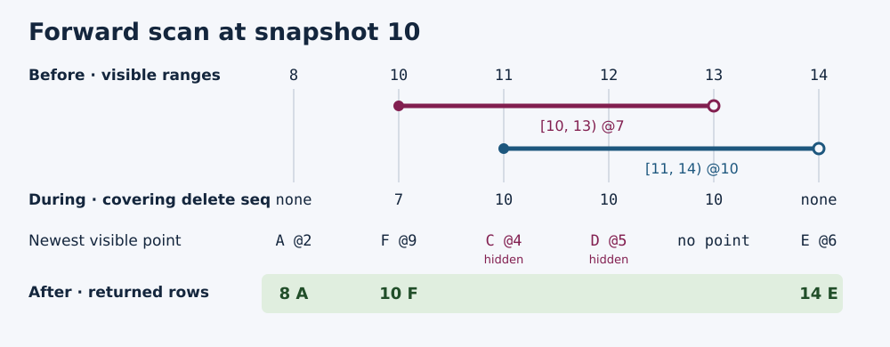

# K-way merge, sweep-line tombstones, and snapshot semantics

A reader at sequence S needs the state after all operations through S. Older
point versions may live in several runs. A range tombstone records a delete of
every key in a half-open span. A later point write can restore one of those keys.



Point runs are sorted by key ascending and sequence descending. Sequences are
globally unique across points and ranges. Empty and reversed ranges have no
effect. The result has at most one row per key in ascending key order. A point
delete at the newest visible point ends the search for that key. A put at p
survives when no visible covering range exists or p exceeds its largest
sequence. Start equality covers a key. End equality excludes it.

The heap keeps a current head per nonempty run. A loser tree pads to a power of
two, stores each match's losing run, and replays the path from the consumed
winner. Absent heads lose to all real keys. Flat sort copies all point versions.
All three share the forward visibility pass. It admits visible starts and
lazily pops expired maximum-sequence ranges. Buried expired ranges can occupy
space until they reach the top. Chronological replay independently applies all
visible operations to a map and physically removes covered live keys.

With k runs and n points, the heap costs O(k + n log(k+1)) work and O(k) head
space. The padded loser tree with p leaves builds p-1 matches and performs
log2(p) matches per point. With three runs, eight example points, and four
leaves, that is 3 + 8*2 = 19 matches. Flat sort takes O(n log(n+1)) work and
O(n) point space. With t input ranges and u unique point keys, the visibility
pass adds O(t log(t+1) + u) work apart from consuming n points and returning
rows. The two example ranges can each be pushed and popped once. A visible
point delete lets the scan defer sweep maintenance until the next visible put.

```sh
cargo test -p k-way-merge-tombstones-and-snapshots
cargo run --release --example snapshot -- demo
cargo build --release --example snapshot
python3 benches/compare.py ../../target/release/examples/snapshot results.jsonl
```

Run from this topic directory inside the workspace. A standalone copy uses
`target/release/examples/snapshot` as the benchmark binary. The demo returns
five rows at S=6, two at S=8, three at S=10, and three at S=12. It prints exact
keys and values. See [the benchmark decision](BENCHMARK.md) and
[measurements](measurements/README.md) for selection.

The model covers resident input and forward scans. A shared-snapshot fragment
index, reverse iteration, compaction and reclamation require separate contracts.
Before eliding a range delete, prove that all required snapshots keep the same
views, including older keys in files outside the inputs.

Primary sources: [RocksDB range deletion](https://github.com/meta/rocksdb/wiki/DeleteRange-Implementation),
[RocksDB merge iteration](https://github.com/meta/rocksdb/blob/main/table/merging_iterator.cc),
[LevelDB snapshot iteration](https://github.com/google/leveldb/blob/main/db/db_iter.cc),
and [TLX loser trees](https://tlx.github.io/group__tlx__container__loser__tree.html).
